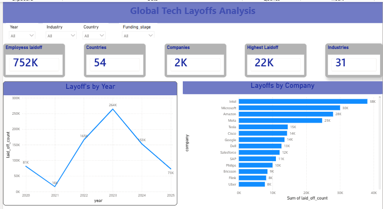
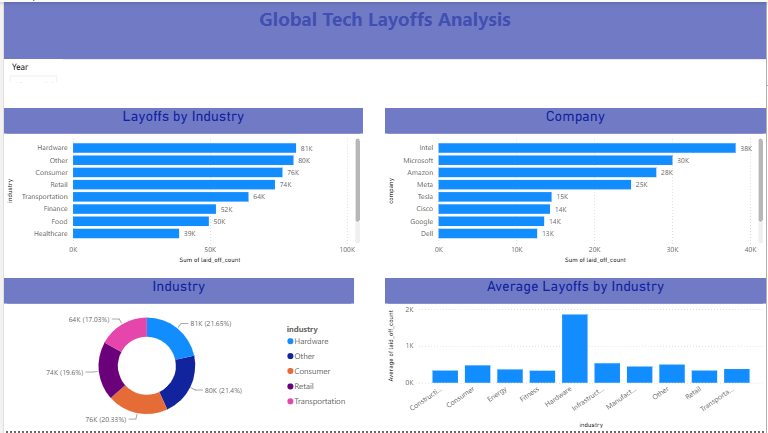
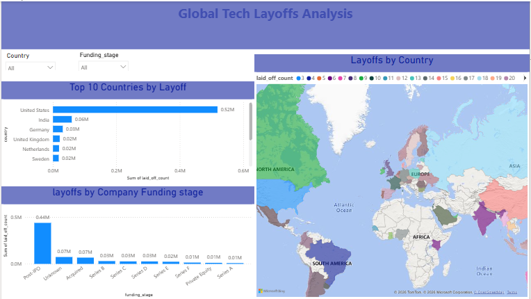
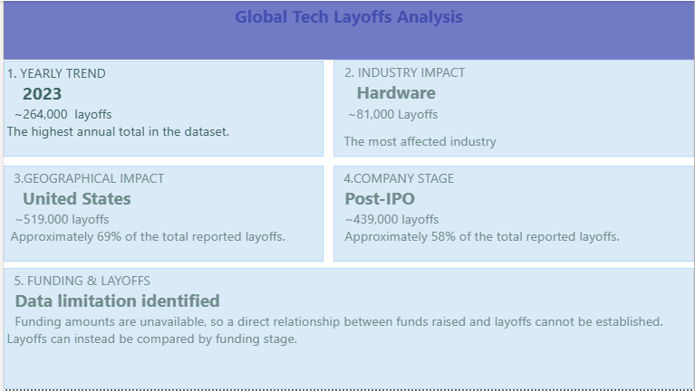

# Global Tech Layoffs Analysis

## Project Overview

This project analyses global technology-sector layoffs from March 2020 to July 2025 using Microsoft Power BI. The analysis explores layoff trends over time and compares layoffs across companies, industries, countries, and company stages.

The project presents the findings through an interactive Power BI report containing **4 dashboard pages**, supported by KPI cards, charts, and visual comparisons.

## Project Objectives

- Analyse yearly and monthly layoff trends.
- Identify the companies and industries most affected by layoffs.
- Compare layoffs across different countries.
- Examine layoffs by company funding stage.
- Present key findings through interactive data visualisations.
- Support data-driven understanding of technology-sector layoff patterns.

## Tools and Technologies

- Microsoft Power BI
- Data cleaning and transformation
- Data visualisation
- KPI reporting
- Trend and comparative analysis

## Key Performance Indicators (KPIs)

| KPI | Value |
|---|---:|
| Total employees laid off | 752,040 |
| Total layoff events | 2,673 |
| Companies affected | 1,913 |
| Countries represented | 54 |
| Industries represented | 30 |

## Dashboard Structure

The Power BI report contains **4 dashboard pages**, each focusing on a different aspect of the analysis.

### 1. Overview Dashboard

Provides a high-level summary of global technology layoffs, including the main KPIs and an overview of layoff patterns.

### 2. Company Analysis Dashboard

Examines layoffs across companies and industries to identify major contributors and the sectors most affected.

### 3. Geographical Analysis Dashboard

Explores the geographical distribution of layoffs and compares the impact across countries.

### 4. Key Insights Dashboard

Presents the key findings and important takeaways identified through the analysis.

## Key Findings

- **2023 recorded the highest annual layoffs**, with approximately 264,220 employees laid off.
- January 2023 was the highest-layoff month highlighted in the analysis.
- The United States accounted for approximately 69% of total layoffs.
- Post-IPO companies accounted for approximately 58% of total layoffs.
- Hardware, Consumer, and Retail were among the industries with substantial layoffs.
- The top 10 companies accounted for approximately 26% of total layoffs.
- Intel recorded the largest single layoff event highlighted in the project, involving 22,000 employees in April 2025.

## Project Files

- `Global Tech Layoff Analysis .pbix` — Power BI report file.
- `Global_Tech_Layoffs_Analysis.pptx` — Project presentation.
- `Overview.PNG` — Overview dashboard screenshot.
- `Company_Analysis.PNG` — Company analysis screenshot.
- `Geographical_Analysis.PNG` — Geographical analysis screenshot.
- `Keyinsights.PNG` — Key insights screenshot.

## Limitations

- Funding amount data was unavailable, so the relationship between funding amounts and layoffs could not be analysed.
- Company employee headcount data was unavailable, so layoffs as a percentage of each company's total workforce could not be calculated.
- Data for 2025 covers only up to early July.

## Conclusion

This project provides an overview of global technology-sector layoffs from March 2020 to July 2025. Through four Power BI dashboard pages, it highlights trends over time and differences across companies, industries, countries, and company stages.

The analysis demonstrates how business intelligence tools can transform data into meaningful visual insights that support reporting and data-driven decision-making.
